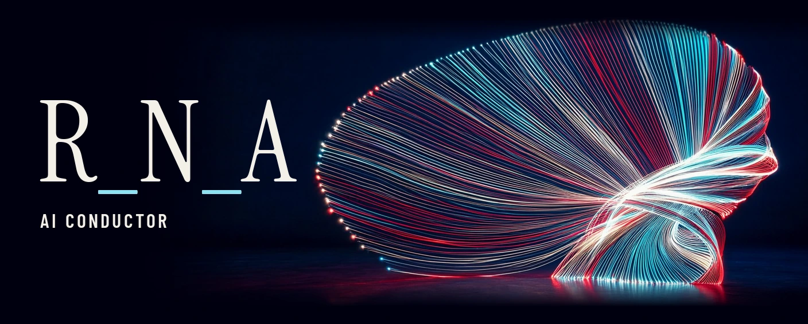

<picture>
  <source media="(max-width: 600px)" srcset="https://raw.githubusercontent.com/RNA4219/RNA4219/main/assets/rna-sleeve-mobile.webp">
  
</picture>

**AIコンダクターの R_N_A です。** 論文を追う仕組みを作ったり、Android実機で言語モデルを動かしたりしています。趣味でAIを利用した創作もします。

AIに画面のデザインを任せるために、美術館のサイトやゲームの画面を調べさせました。どの書体を選んだのか。なぜその余白を取ったのか。制作者が語った理由を、AIが次の画面を作るときにも参照できるようにしたのが **Anything Frontend Art Direction** です。[スキルと作例を見る](https://github.com/RNA4219/anything-frontend-art-direction)

## 技術の代表作 · Quality Evidence Graph

**昨日通ったテストを、今日のリリースの根拠にできるか。** QEGは、変更・リスク・テスト・実行記録をつなぎ、何をいつ検証したかをたどれるようにします。どの記録を根拠にしてリリースを認めるか、その基準もコードと一緒に公開しています。[QEGの実装](https://github.com/RNA4219/quality-evidence-graph) · [証拠を採用する基準](https://github.com/RNA4219/quality-evidence-graph/blob/main/docs/spec/evidence-acceptance-standard.md)

ログインの手動テストを廃止する公開例では、同じリスクを自動テストで5回連続検証し、手動に戻す条件も記録できたケースに `go` が出ます。後継テストがまだ手動だったケースは `DQ-14` で失格です。[成功例の入力](https://github.com/RNA4219/quality-evidence-graph/tree/v0.4.2/fixtures/positive-placement-change-retirement) · [失格理由の出力](https://github.com/RNA4219/quality-evidence-graph/blob/v0.4.2/fixtures/negative-retirement-manual-replacement/expected-gate-verdict.json)

2件の判定図と、Rust実装の計測結果を見る

<picture>
  <source media="(max-width: 600px)" srcset="https://raw.githubusercontent.com/RNA4219/RNA4219/main/assets/qeg-score-mobile.png">
  
</picture>

CLI、Node.js API、GitHub Actionsで同じRustの判定ロジックを使います。Node.jsからRustを直接呼ぶ実装では、Windows x64で同じサンプルを繰り返し判定したときの中央値が **11.38 ms → 0.144 ms** になりました。[実装と計測条件](https://github.com/RNA4219/quality-evidence-graph/pull/19) · [QEGの設計と使い方](https://github.com/RNA4219/quality-evidence-graph/blob/main/README_JA.md)

## 調査と実機

- **RanD** で論文やAIニュースを集め、評価した結果をMarkdownで読めるようにしています。[調査を実行する](https://github.com/RNA4219/RanD#readme)
- **LLM Atelier** では、Android端末でローカルAIを動かしています。Snapdragon 8 Gen 3搭載のnubia実機で、会話モデルの全43層をNPUに載せ、日本語の応答を確かめました。[実装とAPK](https://github.com/RNA4219/llm-atelier)

## 音楽と画面 · DEAD AIR FM

87.9 MHzはダークエレクトロ。92.4 MHzに合わせると周波数表示が一瞬乱れ、アンビエントダブに切り替わります。YuE2で作った3曲とイラストを、一枚のHTMLに収めました。[放送を聴く](https://rna4219.github.io/anything-frontend-art-direction/examples/dead-air-fm/) · [制作に使ったデザインスキル](https://github.com/RNA4219/anything-frontend-art-direction)
