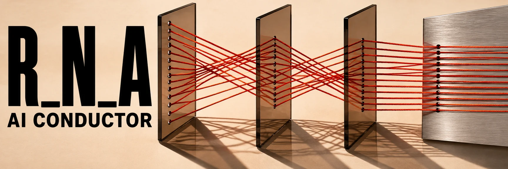
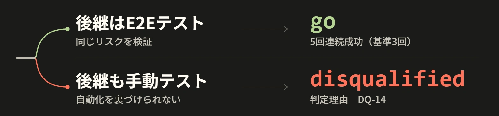

<h1></h1>

AIコンダクターのR_N_Aです。研究でも作品づくりでも、どのAIに何を任せ、どこで自分が確かめるかを決めています。工程をつなぐ道具も作ります。

## 技術の代表作 · Quality Evidence Graph

**テストは通った。この変更をリリースしていいか？**

QEGは、コードの変更から要求、リスク、テストの実行記録までをグラフで結び、リリースできるかを理由とともに返します。[QEGの概要と使い方](https://github.com/RNA4219/quality-evidence-graph/blob/main/README_JA.md)

たとえば、ログインの手動テストを自動化して廃止する場面。QEGは、後継テストが同じリスクを確かめた記録と、手動に戻す条件までたどります。

<picture>
  <source media="(max-width: 600px)" srcset="https://raw.githubusercontent.com/RNA4219/RNA4219/main/assets/qeg-verdicts-mobile.webp">
  
</picture>

[廃止を認めた入力例を読む](https://github.com/RNA4219/quality-evidence-graph/tree/main/fixtures/positive-placement-change-retirement) · [矛盾を検出した判定結果を読む](https://github.com/RNA4219/quality-evidence-graph/blob/main/fixtures/negative-retirement-manual-replacement/expected-gate-verdict.json)

判定ロジックはRustで実装し、CLI、Node.js API、GitHub Actionsで共有しています。Node.jsからRustを直接呼び出すようにした結果、Windows x64で同じサンプルを繰り返し判定したときの中央値は **11.38 ms → 0.144 ms** になりました。[実装と計測条件](https://github.com/RNA4219/quality-evidence-graph/pull/19)

## 研究と制作

**RanD** ── 論文やAIニュースを調べ、得られた知見を整理し、評価と通知までつなぐツール。調査を1回動かすと、Markdownのレポートが手元に残ります。[調査を1回実行する](https://github.com/RNA4219/RanD#readme)

**LLM Atelier** ── Android端末で動くローカルAIアプリ。Snapdragon 8 Gen 3搭載のnubia実機で、会話モデルの全43層をNPUに載せ、日本語の応答を確認しました。[実装とAPK](https://github.com/RNA4219/llm-atelier)

**DEAD AIR FM** ── 選局すると周波数表示が一瞬乱れ、次の曲が流れる架空の深夜ラジオ局。YuE2で作った3曲とイラストを、1枚のHTMLに収めました。[ブラウザーで選局して聴く](https://rna4219.github.io/anything-frontend-art-direction/examples/dead-air-fm/)

