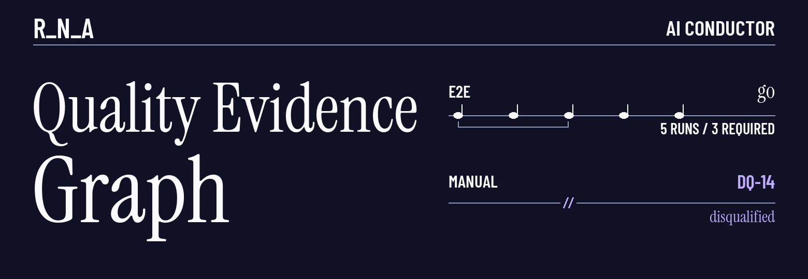
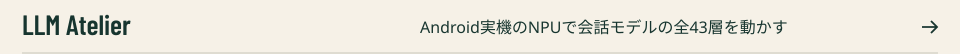
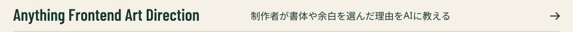

<a href="https://github.com/RNA4219/quality-evidence-graph">
  <picture>
    <source media="(max-width: 600px) and (prefers-reduced-motion: reduce)" srcset="https://raw.githubusercontent.com/RNA4219/RNA4219/main/assets/profile-card-mobile-still.svg">
    <source media="(prefers-reduced-motion: reduce)" srcset="https://raw.githubusercontent.com/RNA4219/RNA4219/main/assets/profile-card-still.svg">
    <source media="(max-width: 600px)" srcset="https://raw.githubusercontent.com/RNA4219/RNA4219/main/assets/profile-card-mobile.svg">
    
  </picture>
</a>

研究でも創作でも、どこをAIに任せ、どこを自分で確かめるかを決めています。工程をつなぐ道具も作ります。

## 昨日通ったテストを、今日も根拠にできるか

Quality Evidence Graph（QEG）は、変更内容とリスクをテストの実行記録に結びつけるツールです。何をいつ確かめたか、その記録を使ってリリースを認めた理由までたどれます。[実装](https://github.com/RNA4219/quality-evidence-graph) · [判定に使う基準](https://github.com/RNA4219/quality-evidence-graph/blob/main/docs/spec/evidence-acceptance-standard.md)

ログインの手動テストを廃止できた例と、失格になった例を見る

ログインの手動テストを廃止したいとき、QEGは代わりのテストの記録を調べます。公開例では、同じリスクを確かめる自動テストが5回続けて成功し、手動テストに戻す条件も記録してあります。この例の判定は `go` です。代わりに別の手動テストを指定した例では、自動化の条件を満たさず `DQ-14` で失格になります。[成功例の入力](https://github.com/RNA4219/quality-evidence-graph/tree/v0.4.2/fixtures/positive-placement-change-retirement) · [失格理由の出力](https://github.com/RNA4219/quality-evidence-graph/blob/v0.4.2/fixtures/negative-retirement-manual-replacement/expected-gate-verdict.json)

<picture>
  <source media="(max-width: 600px)" srcset="https://raw.githubusercontent.com/RNA4219/RNA4219/main/assets/qeg-score-mobile.png">
  
</picture>

CLI、Node.js API、GitHub Actionsは、どれも同じRustのコードで判定します。Windows x64で同じサンプルを繰り返し判定し、処理時間を測りました。Node.jsからRustを直接呼ぶ実装に変えると、中央値は11.38 msから0.144 msに短くなりました。[実装と計測条件](https://github.com/RNA4219/quality-evidence-graph/pull/19) · [QEGの設計と使い方](https://github.com/RNA4219/quality-evidence-graph/blob/main/README_JA.md)

## 道具と作り方

<a href="https://github.com/RNA4219/RanD#readme">
  <picture>
    <source media="(max-width: 600px)" srcset="https://raw.githubusercontent.com/RNA4219/RNA4219/main/assets/work-rand-mobile.svg">
    
  </picture>
</a> 
<a href="https://github.com/RNA4219/llm-atelier">
  <picture>
    <source media="(max-width: 600px)" srcset="https://raw.githubusercontent.com/RNA4219/RNA4219/main/assets/work-atelier-mobile.svg">
    
  </picture>
</a> 
<a href="https://github.com/RNA4219/anything-frontend-art-direction">
  <picture>
    <source media="(max-width: 600px)" srcset="https://raw.githubusercontent.com/RNA4219/RNA4219/main/assets/work-direction-mobile.svg">
    
  </picture>
</a>

[デザインスキルの作り方](https://github.com/RNA4219/anything-frontend-art-direction/blob/main/references/visual-direction.md) · [選局画面の作例「DEAD AIR FM」](https://rna4219.github.io/anything-frontend-art-direction/examples/dead-air-fm/)
