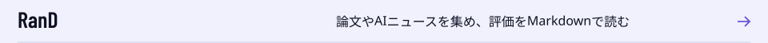

<a href="https://github.com/RNA4219/quality-evidence-graph">
  <picture>
    <source media="(max-width: 600px) and (prefers-reduced-motion: reduce)" srcset="https://raw.githubusercontent.com/RNA4219/RNA4219/main/assets/profile-card-mobile-still.svg?v=4">
    <source media="(prefers-reduced-motion: reduce)" srcset="https://raw.githubusercontent.com/RNA4219/RNA4219/main/assets/profile-card-still.svg?v=4">
    <source media="(max-width: 600px)" srcset="https://raw.githubusercontent.com/RNA4219/RNA4219/main/assets/profile-card-mobile.svg?v=4">
    
  </picture>
</a>

論文を読むときも画面を作るときも、どこをAIに任せて、どこを自分の目で確かめるかを決めています。
たとえばRanDは、ネット上の不満や要望を集めて要件の候補をまとめる調査ツールです。
どの要望を採用するかは、人が候補ごとの根拠を読んで判断できます。

## 代表作　Quality Evidence Graph

リリースを決めたあとからでも、「何を変えたか」「何が壊れそうか」「どのテストで確かめたか」をたどれるように、Quality Evidence Graph（QEG）を作りました。
どんなテスト結果ならリリースの根拠にできるか、判定の条件をコードと一緒に公開しています。 [判定基準](https://github.com/RNA4219/quality-evidence-graph/blob/main/docs/spec/evidence-acceptance-standard.md) · [実装](https://github.com/RNA4219/quality-evidence-graph)

<details>
<summary>ログインの手動テストはいつやめていい？　二つの判定を比べる</summary>

[ログインの手動テストを廃止する例](https://github.com/RNA4219/quality-evidence-graph/tree/v0.4.2/fixtures/positive-placement-change-retirement)では、同じリスクを調べる自動テストが5回続けて成功し、手動テストに戻す条件も記録されています。
この例の判定は `go` です。
代わりに別の手動テストを指定した例は、自動化の条件を満たさず、`DQ-14` で失格になります。 [失格理由の出力](https://github.com/RNA4219/quality-evidence-graph/blob/v0.4.2/fixtures/negative-retirement-manual-replacement/expected-gate-verdict.json)

<picture>
  <source media="(max-width: 600px)" srcset="https://raw.githubusercontent.com/RNA4219/RNA4219/main/assets/qeg-score-mobile.png">
  
</picture>

手元で判定を比べるには、安定版のRustとCargoを用意し、QEG v0.4.2のルートディレクトリで次の2行を実行してください。 [v0.4.2のソース](https://github.com/RNA4219/quality-evidence-graph/tree/v0.4.2)

```sh
cargo run --quiet --locked -- gate fixtures/positive-placement-change-retirement
cargo run --quiet --locked -- gate fixtures/negative-retirement-manual-replacement
```

CLIでもNode.js APIでもGitHub Actionsでも、判定には同じRustのコードを使っています。
Node.jsからRustを直接呼ぶように変え、Windows x64で `positive-release-go` の判定時間を測りました。
1回あたりの平均を12組の計測で比べると、その中央値は11.38 msから0.144 msに短くなりました。 [実装と計測条件](https://github.com/RNA4219/quality-evidence-graph/pull/19) · [QEGの設計と使い方](https://github.com/RNA4219/quality-evidence-graph/blob/main/README_JA.md)

</details>

## ツールと作り方

<a href="https://github.com/RNA4219/RanD#readme">
  <picture>
    <source media="(max-width: 600px)" srcset="https://raw.githubusercontent.com/RNA4219/RNA4219/main/assets/work-rand-mobile.svg">
    
  </picture>
</a><br>
<a href="https://github.com/RNA4219/llm-atelier">
  <picture>
    <source media="(max-width: 600px)" srcset="https://raw.githubusercontent.com/RNA4219/RNA4219/main/assets/work-atelier-mobile.svg">
    
  </picture>
</a><br>
<a href="https://github.com/RNA4219/anything-frontend-art-direction">
  <picture>
    <source media="(max-width: 600px)" srcset="https://raw.githubusercontent.com/RNA4219/RNA4219/main/assets/work-direction-mobile.svg">
    
  </picture>
</a>

画面を作るときは、まず実際に載せるものを一つ選び、それを見た人に何を判断してほしいかを決めます。 [題材から画面を設計する手順](https://github.com/RNA4219/anything-frontend-art-direction/blob/main/references/visual-direction.md) · [選局画面の作例「DEAD AIR FM」](https://rna4219.github.io/anything-frontend-art-direction/examples/dead-air-fm/)
